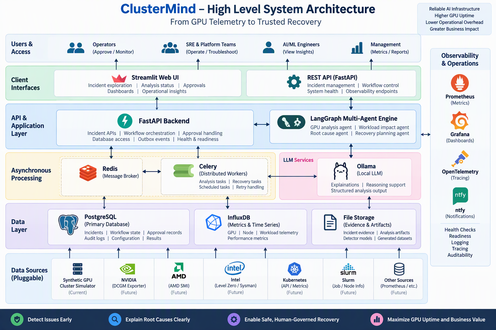
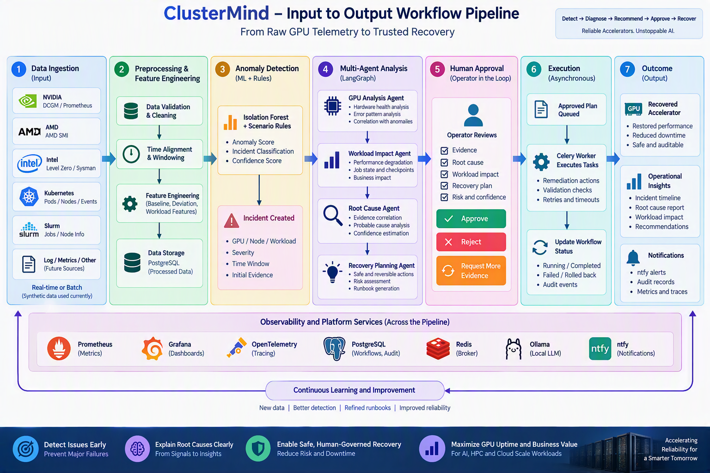

# ClusterMind: Workload-Aware GPU Reliability, Diagnosis & Human-Governed Recovery

[](https://fastapi.tiangolo.com/)
[](https://www.langchain.com/langgraph)
[](https://scikit-learn.org/)
[](https://www.postgresql.org/)
[](https://redis.io/)
[](https://docs.celeryq.dev/)
[](https://streamlit.io/)
[](https://grafana.com/)
[](https://prometheus.io/)
[](https://opentelemetry.io/)
[](https://www.docker.com/)
[](https://github.com/dhaya56/ClusterMind-Workload-Aware-GPU-Reliability-and-Recovery/actions/workflows/ci.yml)

**ClusterMind is a vendor-neutral, workload-aware reliability control plane for the GPU and accelerated-computing infrastructure behind modern AI.** Designed for the high-density data centers, cloud GPU platforms, AI research labs, large-scale training clusters, inference fleets, and HPC facilities operating across the NVIDIA, AMD, and Intel accelerator ecosystems, ClusterMind transforms fragmented GPU, node, and workload telemetry into explainable operational decisions. The platform detects abnormal behavior, quantifies workload impact, identifies evidence-supported root causes, and generates safe, reversible recovery plans for human approval. By combining multi-agent intelligence with durable asynchronous execution, automatic stale-workflow recovery, transactional notifications, and end-to-end observability, ClusterMind shortens the path from hardware signal to operational response while keeping high-risk remediation under strict human control. The result is a safer, more explainable, and recovery-aware approach to protecting expensive accelerator capacity and mission-critical AI workloads.

ClusterMind turns a low-level infrastructure signal into a governed operational decision through one durable workflow:

>**GPU signal → workload impact → probable root cause → safe recovery plan → human decision → durable audit trail**

---

## Table of Contents

- [Problem Statement](#problem-statement)
- [Why ClusterMind](#why-clustermind)
- [What Makes ClusterMind Different](#what-makes-clustermind-different)
- [Platform at a Glance](#platform-at-a-glance)
- [Key Capabilities](#key-capabilities)
- [Dataset and Evidence Pipeline](#dataset-and-evidence-pipeline)
- [System Architecture](#system-architecture)
- [Input-to-Outcome Workflow](#input-to-outcome-workflow)
- [Reliability Scenarios](#reliability-scenarios)
- [Business Impact](#business-impact)
- [Key Performance Indicators](#key-performance-indicators)
- [Technology Stack](#technology-stack)
- [Quick Start](#quick-start)
- [Run an Analysis](#run-an-analysis)
- [API Reference](#api-reference)
- [Testing and Quality Gates](#testing-and-quality-gates)
- [Reliability and Safety Model](#reliability-and-safety-model)
- [Repository Map](#repository-map)
- [Excluded and Generated Files](#excluded-and-generated-files)
- [Product Roadmap](#product-roadmap)
- [Explore by Role](#explore-by-role)
- [Current Boundaries](#current-boundaries)

---

## Problem Statement

Modern AI and HPC platforms operate expensive accelerator fleets where a single reliability issue can appear simultaneously as a hardware anomaly, a distributed-training slowdown, an inference latency increase, and a business-impacting service degradation.

Existing monitoring tools expose individual parts of this picture, but operators must still correlate device metrics, node health, workload behavior, detector output, logs, checkpoint availability, resource ownership, and recovery constraints manually.

A trustworthy reliability system must answer five connected questions:

1. **What changed in the accelerator or node?**
2. **Which workload is affected, and how severely?**
3. **What is the probable root cause, and what evidence supports it?**
4. **What recovery action is safe, reversible, and compatible with the workload state?**
5. **How can the decision be executed durably, observed, audited, and recovered after infrastructure failure?**

---

## Why ClusterMind

GPU reliability is not only a hardware-monitoring problem. A temperature increase, clock reduction, memory fault, power cap, or interconnect degradation becomes operationally important when it affects an expensive training job, a latency-sensitive inference service, an HPC workload, or shared accelerator capacity.

Organizations may already use device exporters, monitoring dashboards, anomaly detectors, alerting systems, workload schedulers, ticketing platforms, runbooks, and internal recovery scripts. However, these tools often operate as separate layers, leaving engineers to manually connect hardware symptoms with workload impact, probable root cause, recovery constraints, and operational risk.

Traditional monitoring and automation therefore leave three critical gaps:

1. **Telemetry without workload context** — operators can see device-level metrics but may not know which workload is affected, whether useful work is still progressing, whether a checkpoint is available, or what the business consequence will be.

2. **Alerts without defensible explanation** — thresholds and anomaly scores can identify unusual behavior, but they do not automatically reconstruct an evidence-supported root cause by correlating GPU, node, workload, and incident-timeline data.

3. **Automation without governance** — aggressive remediation can interrupt expensive jobs, discard recoverable progress, violate placement constraints, or increase the operational blast radius when actions are executed without validation and human oversight.

ClusterMind provides the missing reliability-intelligence and workflow layer between these existing systems. It correlates accelerator health with workload behavior, converts anomalies into structured incident evidence, identifies probable causes, generates safe and reversible recovery recommendations, and preserves human control over high-risk remediation.

Rather than requiring organizations to replace their current monitoring, scheduling, observability, or notification platforms, ClusterMind is designed to integrate with them and transform fragmented operational signals into one explainable, durable, and auditable incident lifecycle.

---

## What Makes ClusterMind Different

- **Workload-aware, not metric-only:** Correlates accelerator health with throughput, latency, job state, errors, restarts, and checkpoint availability.

- **Evidence-grounded, not prompt-only:** Builds every diagnosis from validated telemetry, anomaly scores, workload context, incident timelines, and recovery runbooks.

- **Human-governed by design:** Keeps high-risk remediation as a recommendation until an authorized operator approves, rejects, or requests more evidence.

- **Durable and recoverable:** Persists workflows, task ownership, heartbeats, retries, decisions, and audit events while automatically recovering stale executions.

- **Model-optional and fail-safe:** Uses local LLM assistance when available while preserving reliable operation through deterministic analysis and runbook fallbacks.

- **Concurrency-safe:** Prevents conflicting approval decisions through PostgreSQL row locking, immutable records, and idempotent workflow transitions.

- **Transactionally reliable:** Records notifications through an outbox so committed events survive temporary delivery failures and can be retried safely.

- **Vendor-neutral at the core:** Separates normalized telemetry and agent contracts from future NVIDIA, AMD, Intel, Kubernetes, and Slurm integrations.

- **Operationally complete:** Connects detection, diagnosis, recovery planning, human approval, notifications, observability, auditing, and workflow recovery in one incident lifecycle.

---

## Platform at a Glance

| Engineering Signal | Verified Baseline | Why It Matters |
|---|---:|---|
| Synthetic telemetry rows | **120,960** | Provides reproducible GPU, node, and workload behavior for development and CI |
| Reliability incidents | **35** | Exercises multiple fault classes and operational paths |
| Healthy controls | **10** | Helps distinguish harmful anomalies from productive high utilization |
| Reliability scenarios | **7** | Covers thermal, memory, power, fabric, utilization, and healthy behavior |
| Unit tests | **84 passing** | Protects data, API, worker, recovery, and failure-path behavior |
| PostgreSQL integration tests | **2 passing** | Verifies stale-claim recovery and concurrent human decisions |
| CI quality gates | **3 jobs** | Validates quality, database integration, and Docker builds |
| Workflow recovery scan | **Every 60 seconds** | Detects and redispatches abandoned work |
| Stale heartbeat threshold | **300 seconds** | Bounds recovery delay for interrupted workers |
| Outbox publication scan | **Every 15 seconds** | Delivers committed notifications without losing events |

> **Important:** these are engineering and validation KPIs from the implemented platform. Business savings such as reduced MTTR or GPU-hours preserved must be measured in a real-cluster pilot before being presented as achieved outcomes.

---

## Key Capabilities

### Data & Detection

- Deterministic generation of GPU, node, and workload telemetry
- Seven reliability and healthy-control scenarios
- Schema validation, timestamp alignment, rolling baselines, and feature engineering
- Isolation Forest anomaly detection with persisted model artifacts
- Incident windows, ground-truth labels, healthy controls, and reproducible manifests

### Multi-Agent Intelligence

- **GPU Telemetry Agent** — interprets device health and anomaly evidence
- **Workload Impact Agent** — quantifies throughput, latency, error, and checkpoint impact
- **Root-Cause Agent** — ranks probable causes using evidence and validated runbooks
- **Recovery Planning Agent** — proposes reversible actions, safety checks, expected outcomes, and rollback procedures
- **LangGraph orchestration** — coordinates stateful analysis through a human approval gate

### Durable Async Backend

- HTTP `202 Accepted` analysis dispatch through FastAPI
- Redis broker and result-backend separation
- Celery worker claims, heartbeats, ownership, and late acknowledgements
- PostgreSQL workflow, agent, approval, audit, and outbox persistence
- Duplicate-delivery protection and idempotent workflow transitions
- Celery Beat schedules for outbox delivery and stale-workflow recovery

### Safety & Governance

- Human approval required before high-risk recovery
- Mandatory reasons for rejection and evidence requests
- PostgreSQL row locking for concurrent decisions
- Exactly one conflicting decision can win
- Immutable audit and approval history
- No direct LLM execution of shell or infrastructure commands

### Observability & Operations

- Liveness and dependency-readiness APIs
- Prometheus metrics for HTTP, workflow lifecycle, stale claims, and pending outbox events
- Grafana dashboards
- OpenTelemetry traces and Jaeger visualization
- InfluxDB operational telemetry
- Self-hosted ntfy notifications through a transactional outbox

---

## Dataset and Evidence Pipeline

ClusterMind uses a deterministic synthetic dataset because public datasets rarely combine synchronized accelerator telemetry, node health, workload performance, incident windows, recovery context, and ground-truth labels in one operational timeline.

| Dataset | Development Profile | Representative Fields |
|---|---:|---|
| GPU telemetry | **80,640 rows** | utilization, memory, temperature, power, clocks, ECC, XID, NVLink |
| Node telemetry | **20,160 rows** | CPU, memory, network, node power, environmental state |
| Workload telemetry | **20,160 rows** | throughput, latency, step duration, loss, errors, restarts, checkpoints |
| Incidents | **35** | type, severity, affected resource, timestamps, root cause |
| Healthy controls | **10** | productive high utilization used to control false positives |

### How the data is synthesized and used

1. A seeded simulator creates aligned five-minute telemetry intervals.
2. Baselines model nodes, GPUs, training, inference, and HPC-style workloads.
3. Scenario functions inject correlated device and workload changes.
4. Ground-truth incident windows remain separate from detector features.
5. Validation rejects invalid schemas, timestamps, ranges, non-finite values, and overlapping scenarios.
6. Feature engineering creates rolling baselines, deviations, rates, pressure signals, and workload-impact features.
7. Isolation Forest predictions become one evidence source for incident analysis; agents also consume workload context and validated runbooks.

<details>
<summary><strong>Why synthetic evidence is used now</strong></summary>

Synthetic evidence provides deterministic ground truth, repeatable CI, safe rare-fault simulation, and complete end-to-end validation before real hardware access. It is an engineering foundation, not a substitute for a real-cluster pilot.

</details>

### Future near-real-time ingestion

```text
NVIDIA DCGM / AMD SMI / Intel Level Zero / Prometheus / InfluxDB / Kafka
                                  ↓
                      Vendor adapter layer
                                  ↓
                Normalized accelerator telemetry
                                  ↓
      Feature engineering → detection → incident evidence
                                  ↓
                   Existing agent workflow
```

Adapters can poll or stream continuously operating GPU telemetry, preserve device/workload identity, and open incidents when detector and policy conditions are met. Historical replay can use the same normalized schema for model evaluation and incident reconstruction.

### Reproduce the development evidence

```bash
python scripts/generate_dataset.py --profile development --overwrite
python scripts/train_detector.py
```

Generated CSVs, predictions, and model artifacts are excluded from Git and regenerated locally or in CI.

---

## System Architecture



### Architecture layers

1. **Input layer** — synthetic GPU, node, and workload telemetry; extension boundary for vendor adapters.
2. **Processing layer** — validation, normalization, feature engineering, Isolation Forest scoring, and incident evidence collection.
3. **Intelligence layer** — specialized agents for telemetry, impact, root cause, recovery planning, and human approval.
4. **Durable execution layer** — FastAPI, PostgreSQL, Redis, Celery workers, Celery Beat, and transactional outbox.
5. **Observability layer** — Prometheus, Grafana, OpenTelemetry, Jaeger, InfluxDB, and ntfy.

### Design principles

- **Separation of evidence, reasoning, execution, and approval**
- **Durable state before task dispatch**
- **At-least-once delivery with idempotent handlers**
- **Fail-safe deterministic fallbacks**
- **Observable state transitions**
- **Isolated Docker services, volumes, networks, and ports**

---

## Input-to-Outcome Workflow



```text
Incident request or detected anomaly
              ↓
Validate incident and required evidence
              ↓
Create durable PostgreSQL workflow
              ↓
Assign task ID and dispatch through Redis
              ↓
Celery worker claims workflow and emits heartbeat
              ↓
LangGraph multi-agent analysis
              ↓
Persist telemetry, impact, cause, plan, and audit data
              ↓
Operator approves, rejects, or requests more evidence
              ↓
Transactional outbox records and delivers notifications
              ↓
Stale tasks are reset and redispatched automatically
```

### Workflow lifecycle

```text
not_dispatched → pending → dispatched → claimed → completed
                                  ↘ failed
```

A stale claimed workflow is returned to `pending`, its abandoned ownership is cleared, the retry count is incremented, and a fresh Celery task ID is assigned.

---

## Reliability Scenarios

| Scenario | Representative Signals | Workload Effect | Recovery Direction |
|---|---|---|---|
| Thermal throttling | Higher GPU temperature, lower SM clock | Reduced throughput, higher latency | Validate cooling, migrate workload, inspect node |
| ECC memory degradation | Correctable/uncorrectable ECC growth, XID errors | Restarts, instability, possible corruption risk | Preserve checkpoint, isolate GPU, inspect memory health |
| Memory saturation | High memory utilization and pressure | Longer steps, lower throughput, restart risk | Reduce pressure, reschedule, adjust workload placement |
| Power capping | High draw near limit, reduced clocks | Throughput degradation | Validate power policy, monitor, migrate if necessary |
| NVLink degradation | Lower link throughput or link errors | Distributed-job slowdown and stragglers | Inspect fabric, isolate topology issue, relocate workload |
| Idle GPU waste | Low compute with retained allocation | Poor utilization and unnecessary cost | Reclaim allocation or reschedule workload |
| Healthy high utilization | High utilization with stable temperatures and productive work | Positive workload behavior | Suppress false alert and continue monitoring |

---

## Business Impact

ClusterMind is designed for teams running expensive accelerator infrastructure where unplanned downtime, silent degradation, and slow diagnosis translate directly into delayed experiments, missed service objectives, and wasted GPU-hours.

### Stakeholder value

| Stakeholder | Value Delivered |
|---|---|
| GPU / platform operator | A single incident timeline linking device health, workload impact, diagnosis, and recovery options |
| SRE / reliability engineer | Durable workflows, retries, audit records, health probes, metrics, and failure recovery |
| ML / workload owner | Clear explanation of which job is affected, whether a checkpoint exists, and what action is proposed |
| Engineering manager | Measurable operational KPIs and a defensible path from prototype to production pilot |
| Business stakeholder | Reduced time spent correlating fragmented tools and lower risk from ungoverned remediation |

### Target business outcomes for a real-cluster pilot

- Lower **mean time to detect** GPU reliability incidents
- Lower **mean time to diagnose** cross-layer faults
- Lower **mean time to recover** affected workloads
- Fewer false alerts per GPU-day
- More GPU-hours preserved through earlier detection and checkpoint-aware recovery
- Higher operator acceptance of evidence-backed recommendations
- Lower repeated investigation effort through durable incident memory and audit trails

---

## Key Performance Indicators

### Detection KPIs

- Precision, recall, and F1 by incident type
- False positives per GPU-day
- Detection latency from first abnormal signal
- Healthy high-utilization suppression rate
- Model confidence and calibration

### Diagnosis KPIs

- Root-cause top-1 and top-3 accuracy
- Evidence completeness
- Agent execution latency
- Deterministic fallback frequency
- Operator agreement with the identified root cause

### Recovery KPIs

- Recommendation acceptance rate
- Time from detection to approved plan
- Retry and stale-recovery counts
- Rollback rate
- GPU-hours preserved
- Workloads recovered without data loss

### Platform KPIs

- API availability and `202 Accepted` dispatch latency
- Workflow completion latency
- Worker readiness and heartbeat age
- Outbox publication delay
- Pending, claimed, completed, failed, and stale workflow counts
- Database migration and CI health

---

## Technology Stack

### Application & Intelligence

<p>
  
  
  
  
  
</p>

### Data & Async Execution

<p>
  
  
  
  
  
  
</p>

### Observability & Delivery

<p>
  
  
  
  
  
  
</p>

---

## Quick Start

### Prerequisites

- Git
- Python 3.12
- Docker Desktop with Docker Compose
- At least 8 GB of free memory recommended for the full local stack
- Optional: Ollama with a compatible local model for enriched explanations

### 1. Clone the repository

```bash
git clone https://github.com/dhaya56/ClusterMind-Workload-Aware-GPU-Reliability-and-Recovery.git
cd ClusterMind-Workload-Aware-GPU-Reliability-and-Recovery
```

### 2. Create the Python environment

#### Windows Command Prompt

```cmd
python -m venv .venv
.venv\Scripts\activate
python -m pip install --upgrade pip
python -m pip install -r requirements.txt
```

#### Linux / macOS

```bash
python -m venv .venv
source .venv/bin/activate
python -m pip install --upgrade pip
python -m pip install -r requirements.txt
```

### 3. Configure the environment

#### Windows Command Prompt

```cmd
copy .env.example .env
```

#### Linux / macOS

```bash
cp .env.example .env
```

Review `.env` before starting the stack. Development defaults are provided, but production credentials must be replaced.

### 4. Generate the development dataset

```bash
python scripts/generate_dataset.py --profile development --overwrite
```

Expected development profile:

```text
GPU telemetry rows:       80,640
Node telemetry rows:      20,160
Workload telemetry rows:  20,160
Incidents:                35
Healthy controls:         10
```

### 5. Train the anomaly detector

```bash
python scripts/train_detector.py
```

This creates the persisted detector and prediction artifacts required by analysis and Docker image builds.

### 6. Start infrastructure dependencies

```bash
docker compose up -d clustermind-postgres redis influxdb
```

### 7. Apply database migrations

```bash
python -m alembic upgrade head
python -m alembic current
python -m alembic check
```

Expected migration head:

```text
20261012_0002 (head)
```

### 8. Start the complete platform

```bash
docker compose up -d --build
```

### 9. Verify platform health

```bash
docker compose ps
```

```bash
curl http://127.0.0.1:18000/api/v1/health
curl http://127.0.0.1:18000/api/v1/readiness
```

### Local endpoints

| Service | URL |
|---|---|
| FastAPI API | `http://localhost:18000` |
| OpenAPI documentation | `http://localhost:18000/docs` |
| Prometheus metrics | `http://localhost:18000/metrics` |
| Grafana | `http://localhost:13000` |
| ntfy | `http://localhost:18080` |

Other infrastructure ports can be reviewed in `docker-compose.yml` and `.env.example`.

---

## Run an Analysis

### Submit an asynchronous incident analysis

```bash
curl -X POST \
  -H "Content-Type: application/json" \
  -d '{"use_llm":false,"force":false}' \
  http://127.0.0.1:18000/api/v1/incidents/INC-2026-0032/analyze
```

Example response:

```json
{
  "workflow_id": "WF-INC-2026-0032-78C20847E484",
  "task_id": "<celery-task-id>",
  "status": "queued",
  "dispatch_status": "dispatched",
  "status_url": "/api/v1/workflows/WF-INC-2026-0032-78C20847E484"
}
```

### Poll the workflow status

```bash
curl http://127.0.0.1:18000/api/v1/workflows/WF-INC-2026-0032-78C20847E484
```

The response exposes lifecycle state, current stage, worker ownership, retry count, timestamps, result availability, and the full analysis result when complete.

### Submit a human decision

```bash
curl -X POST \
  -H "Content-Type: application/json" \
  -d '{"decision":"approved","actor":"operator@example.com"}' \
  http://127.0.0.1:18000/api/v1/workflows/<workflow-id>/decision
```

Supported decisions:

```text
approved
rejected
more_evidence_requested
```

A reason is required for rejection and additional-evidence requests.

---

## API Reference

| Method | Endpoint | Purpose |
|---|---|---|
| `GET` | `/api/v1/health` | Process liveness |
| `GET` | `/api/v1/readiness` | Dependency readiness |
| `GET` | `/api/v1/incidents` | List incidents |
| `GET` | `/api/v1/incidents/{incident_id}` | Incident details and evidence |
| `POST` | `/api/v1/incidents/{incident_id}/analyze` | Queue asynchronous analysis |
| `GET` | `/api/v1/workflows` | List durable workflow states |
| `GET` | `/api/v1/workflows/{workflow_id}` | Workflow progress and result |
| `POST` | `/api/v1/workflows/{workflow_id}/decision` | Approve, reject, or request more evidence |
| `GET` | `/metrics` | Prometheus metrics |

Use the live OpenAPI interface at `http://localhost:18000/docs` for request and response schemas.

---

## Testing and Quality Gates

### Fast unit suite

```bash
python -m pytest tests/unit -q
```

Expected baseline:

```text
84 passed
```

### PostgreSQL integration suite

#### Windows Command Prompt

```cmd
set RUN_POSTGRES_INTEGRATION=1
python -m pytest tests\integration -q
set RUN_POSTGRES_INTEGRATION=
```

#### Linux / macOS

```bash
RUN_POSTGRES_INTEGRATION=1 python -m pytest tests/integration -q
```

Expected baseline:

```text
2 passed
```

### Critical Ruff correctness gate

```bash
python -m ruff check --isolated --select E9,F63,F7,F82 app simulator scripts tests migrations
```

### Migration validation

```bash
python -m alembic heads
python -m alembic current
python -m alembic check
```

### Docker validation

```bash
docker compose config --quiet
docker compose build clustermind-api clustermind-worker clustermind-beat
```

### GitHub Actions CI

Every pull request targeting `main`, and every merge into `main`, runs:

1. **Quality and unit tests**
2. **PostgreSQL integration tests**
3. **Docker validation**

---

## Reliability and Safety Model

| Risk | ClusterMind Control |
|---|---|
| Duplicate task delivery | Idempotent lifecycle transitions and durable task IDs |
| Worker crash | Late acknowledgement, ownership tracking, heartbeat, and stale recovery |
| Broker dispatch failure | Durable failure state and bounded error persistence |
| Conflicting human decisions | PostgreSQL row locks and immutable decision records |
| Notification outage | Transactional outbox with retries and exponential backoff |
| LLM unavailable or invalid | Deterministic runbook fallback |
| Unsafe remediation | Recommendation-only boundary and mandatory human approval |
| Impossible lifecycle timestamps | Database check constraints |
| Schema drift | Alembic drift checks locally and in CI |
| Unrelated Docker impact | Unique ClusterMind project resources and targeted service operations |

---

## Repository Map

```text
ClusterMind/
├── app/
│   ├── agents/              # Specialized analysis agents and LangGraph workflow
│   ├── api/v1/              # Product, workflow, and health APIs
│   ├── core/                # Configuration and application settings
│   ├── db/                  # SQLAlchemy models, sessions, and repositories
│   ├── ml/                  # Detector artifacts and ML components
│   ├── observability/       # Metrics and tracing
│   ├── prompts/             # Model prompts and reasoning templates
│   ├── services/            # Incidents, dispatch, outbox, and runtime services
│   ├── tasks/               # Celery analysis, outbox, recovery, and health tasks
│   └── ui/                  # Streamlit operator interface
├── assets/                  # README visuals and future demo media
├── configs/                 # Runtime and scenario configuration
├── data/                    # Generated data and artifacts, ignored by Git
├── infrastructure/          # Grafana, Prometheus, InfluxDB, and OTel configuration
├── migrations/              # Alembic migration history
├── runbooks/                # Validated recovery knowledge
├── scripts/                 # Dataset, training, seeding, and validation tools
├── simulator/               # Synthetic GPU-cluster generator
├── tests/                   # Unit, integration, and fixtures
├── docker-compose.yml
├── Dockerfile
└── README.md
```

---

## Excluded and Generated Files

The repository excludes machine-specific, generated, secret-bearing, and runtime content so clones stay safe, reproducible, and reviewable.

| Excluded Path / Pattern | Why Excluded | Recreated By |
|---|---|---|
| `.env` | Local credentials, endpoints, and ports | Copy `.env.example` and set local values |
| `.venv/` | Platform-specific Python environment | Create the virtual environment and install requirements |
| `data/generated/` | Large deterministic telemetry CSVs | `scripts/generate_dataset.py` |
| `data/artifacts/` | Predictions and generated evidence | `scripts/train_detector.py` |
| `app/ml/artifacts/` | Persisted detector binaries | Detector training |
| `__pycache__/`, `.pytest_cache/` | Ephemeral interpreter/test caches | Created automatically |
| Logs and temporary files | Runtime-specific and non-portable | Running services |
| Docker named volumes | Database and observability state | Docker Compose |

- CI regenerates datasets and detector artifacts before integration tests and Docker builds.
- Source code, migrations, tests, runbooks, templates, documentation, and small visuals remain tracked.
- Review PowerPoints are included temporarily for academic assessment and can be removed after review.

---

## Product Roadmap

### Implemented foundation

- Synthetic GPU-cluster evidence pipeline
- Baseline anomaly detector
- Multi-agent diagnosis and recovery planning
- Durable asynchronous workflows
- Human approval and audit controls
- Automated stale-workflow recovery
- Transactional notifications
- Health, readiness, metrics, tracing, dashboards, and CI

### Next product phases

1. **UI asynchronous integration** — live polling, stage visualization, approval controls, and operational dashboards.
2. **Telemetry adapter framework** — normalized interfaces for real GPU vendors and monitoring systems.
3. **NVIDIA DCGM integration** — real accelerator telemetry and workload-to-GPU mapping.
4. **Kubernetes and Slurm integration** — scheduler-aware workload correlation and placement context.
5. **Safe recovery execution** — policy-authorized dry runs, verification, rollback, and blast-radius limits.
6. **Evaluation framework** — detection quality, RCA accuracy, recovery effectiveness, and GPU-hours preserved.
7. **Security and multi-tenancy** — OIDC, RBAC, tenant isolation, signed images, SBOMs, and provenance.
8. **AMD and Intel adapters** — AMD SMI and Intel Level Zero/Sysman integrations.
9. **Production deployment** — Helm, high availability, backups, SLOs, load tests, and disaster recovery.

---

## Explore by Role

<details><summary><strong>Recruiter or Engineering Manager — what does this demonstrate?</strong></summary>

End-to-end ownership across data simulation, anomaly detection, agent orchestration, distributed workers, relational modeling, concurrency, recovery engineering, observability, Docker, automated testing, and CI. ClusterMind is an operable platform rather than a notebook-only proof of concept.

</details>

<details><summary><strong>GPU / AI Infrastructure Engineer — where do real accelerators connect?</strong></summary>

Future NVIDIA DCGM, AMD SMI, and Intel Level Zero/Sysman adapters populate normalized telemetry contracts. Kubernetes and Slurm adapters add allocation, checkpoint, topology, placement, and tenant context without replacing the analysis workflow.

</details>

<details><summary><strong>SRE / Platform Engineer — what happens after failure?</strong></summary>

State is persisted before dispatch. Workers claim tasks using durable ownership and heartbeat timestamps. Late acknowledgements and idempotent transitions protect duplicate delivery. Celery Beat recovers stale claims, while a transactional outbox protects committed notifications.

</details>

<details><summary><strong>Business Stakeholder — what value can a pilot measure?</strong></summary>

A real-cluster pilot can measure MTTD, time to diagnosis, MTTR, false positives per GPU-day, GPU-hours preserved, recommendation acceptance, and operator time saved.

</details>

---

## Current Boundaries

ClusterMind is a production-oriented engineering prototype, not yet a production deployment for a live accelerator fleet.

The current end-to-end path uses deterministic synthetic evidence. The following remain extension milestones:

- Real NVIDIA, AMD, and Intel telemetry adapters
- Kubernetes and Slurm scheduler integration
- Authenticated multi-tenant operation
- Policy-authorized recovery execution
- High-availability deployment
- Real-cluster benchmark evidence

The repository deliberately separates **implemented capability** from **planned extension** to keep technical claims verifiable.
